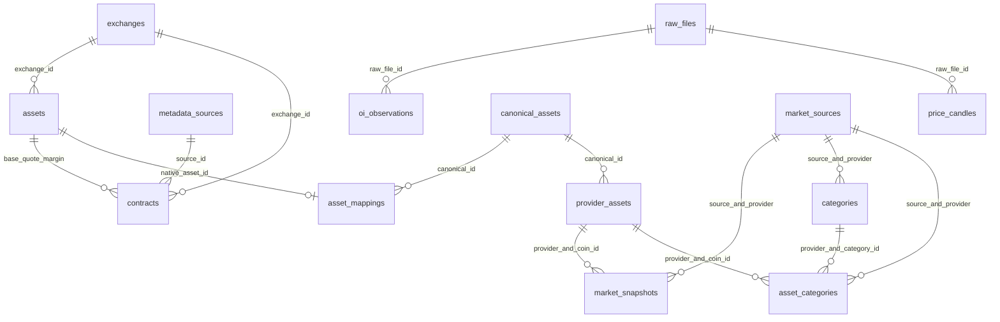

# CoinGecko database foundation — schema version 3

This milestone adds seven tables without replacing the original seven. There is no API client, scheduled CoinGecko capture, analytics or new contract universe. Existing Binance collection continues unchanged.

| Table | Purpose |
|---|---|
| canonical_assets | Internal identities independent of providers: asset:bitcoin and asset:pepe |
| provider_assets | CoinGecko coin ID → canonical identity, evidence and verification date |
| asset_mappings | Exchange-native identity → canonical candidate; verified or pending |
| market_sources | Future captured-response identity, provider, retrieval milliseconds and checksum |
| market_snapshots | Historical USD measurements tied to provider identity and source capture |
| categories | Provider category IDs and names, with source provenance |
| asset_categories | Many-to-many memberships observed in individual source captures |

## Identity evidence and uncertainty

Reviewed 2026-11-06. [Binance Bitcoin](https://www.binance.com/en/price/bitcoin) and [CoinGecko Bitcoin](https://www.coingecko.com/en/coins/bitcoin) identify the named Bitcoin network asset, supporting Binance BTC → asset:bitcoin → CoinGecko bitcoin. This is a manually reviewed mapping, not an automatic ticker match.

[CoinGecko Pepe](https://www.coingecko.com/en/coins/pepe) links the Ethereum token at `0x6982508145454ce325ddbe47a25d4ec3d2311933` and pepe.vip. This establishes asset:pepe → CoinGecko pepe. The [Binance futures announcement](https://www.binance.com/en/support/announcement/detail/41993e3389654713946bcb6b9b032eaf) identifies the native 1000PEPE underlying, but the examined evidence does not explicitly link that derivative to this token address. The native mapping is therefore **pending**, not verified. `resolve_asset` returns None for pending, absent or bare-ticker lookups. This remaining verification requirement is deliberately visible.

Identity is separate from quantity. No multiplier is stored or inferred in these mappings. Existing contract_size, underlying_multiplier and multiplier_evidence remain unchanged and NULL. A verified identity alone would not authorize quantity conversion.

## Financial and historical semantics

Prices, market cap, FDV and 24-hour volume are USD; supply is in canonical native coins/tokens. Market cap represents circulating-supply valuation, FDV represents a provider's fully diluted valuation, and neither is derivatives open-interest notional. USDT-denominated Binance notional must not be silently compared as USD.

Decimal measurements use TEXT. `measurement_text` accepts Decimal or decimal strings, preserves precision and NULL, and rejects floats, negative and nonfinite inputs. Future ingestion must call this validation: direct SQL can still insert malformed financial text, as with the existing application-validated schema. No financial measurements have been seeded.

Provider timestamps are nullable INTEGER Unix milliseconds; missing timestamps are not replaced with retrieval time. Retrieval belongs to market_sources. A unique source/provider-coin/currency key prevents duplicate insertion from one capture; new captures retain separate historical observations, including provider revisions. A source must belong to the same provider as its measurement or category. Currency is constrained to USD for this milestone.

Membership records retain capture-specific presence; absence is not a proven removal unless the future client records and validates a complete membership snapshot. Category definitions currently represent a current name with source provenance, not effective-dated naming history. Do not build category-change analytics yet.

## Actual relationships



All edges represent enforced FKs when SQLite foreign_keys is enabled. Contracts reach canonical assets through their native base_asset_id and a **verified** asset_mappings row. The original observation-to-contract symbol join remains logical, not an enforced FK. [Version 2 column diagram](implemented-schema.md) remains a historical reference; new DDL is in storage/foundation.py.

## Validation and operations

85 deterministic tests pass, including migration repeatability, old-row preservation, missing/pending identities, duplicate/FK rejection, NULL measurements, exact decimals, USD enforcement and many-to-many categories. The live upgrade preserved every original table row under the collector lock, with an integrity-checked pre-upgrade backup under data/db/backups. The existing audit now compares all fourteen tables rather than describing a fixed seven-table schema. Two isolated ordinary offline replays preserve every row.

Fresh installations seed mappings after Binance native assets exist. Subsequent loads do not overwrite reviewed mappings. This is database preparation only: mapping review remains necessary before PEPE cross-provider joins. The next separately approved milestone will add the client, raw capture and validated snapshot/category ingestion with mocked API tests.

```bash
cd /Users/b/Developer/crypto-perpetuals-data-pipeline
source .venv/bin/activate
python -m pytest -q
python scripts/validate_pipeline.py
python -m crypto_pipeline.schedule status
git show --stat HEAD
```

Do not run the audit with Python -O (assertions must stay enabled). If a scheduled run holds the lock, rerun after it finishes. No scheduler changes or live CoinGecko API calls are needed.
