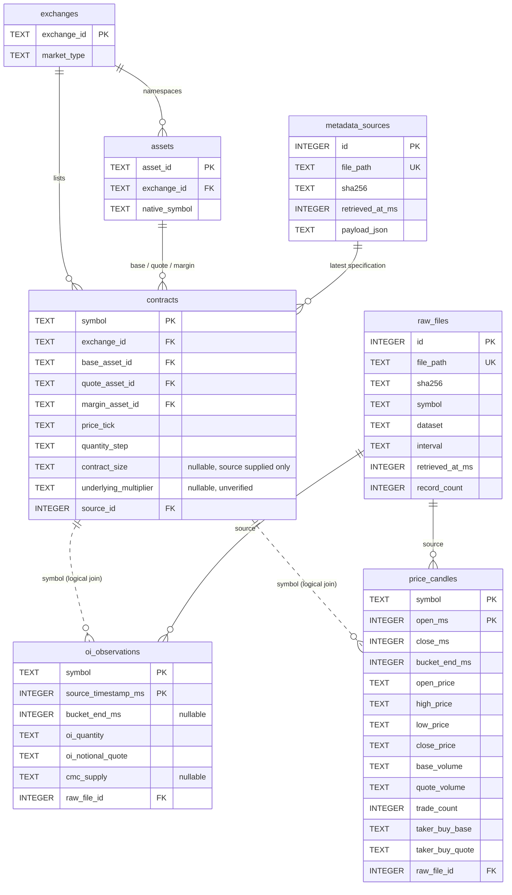
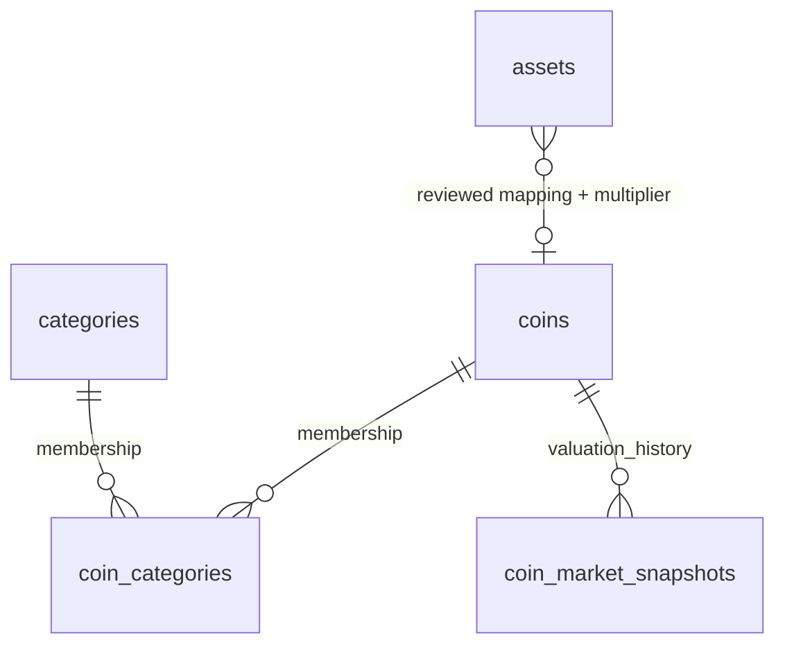

# Data model and units

## Implemented relationships (schema version 2)



Dotted relationships are application joins, **not enforced foreign keys**. The original observation tables remain intact, including support for historical files without metadata. Reference tables have enforced foreign keys on pipeline connections. Before supporting another exchange, migrate observation keys to include an exchange/contract ID; symbol alone is deliberately still Binance-only.

`contracts` also retains `contract_type`, `status`, `multiplier_evidence`, `retrieved_at_ms`, and the complete selected `specification_json`. `metadata_sources` retains every imported response, checksum, retrieval time and path. Older snapshots cannot overwrite newer specifications. Source retrieval time is not an assertion of when a specification became effective.

## What is currently stored

Verified on November 6, 2026 after migration:

| Table | Rows | Meaning |
|---|---:|---|
| raw_files | 48 | Includes older 1m files; indexed does not mean normalized |
| oi_observations | 30 | 15 native OI observations per contract |
| price_candles | 18 | 9 completed 5m candles per contract |
| exchanges | 1 | Binance USDⓈ-M market namespace |
| assets | 3 | BTC, 1000PEPE, USDT (exchange-native identifiers) |
| contracts | 2 | BTCUSDT and 1000PEPEUSDT |
| metadata_sources | 1 | Actual saved exchangeInfo response |

There are 9 aligned OI/candle pairs for each contract. The latest stored candle period ends at 2026-11-06 19:05:00 UTC. This is a small sampled dataset, not continuous historical coverage.

## Time and decimal rules

- All persisted timestamps are integer Unix **milliseconds in UTC**. Retrieval timestamps come from UTC filenames, truncating sub-millisecond precision using integer arithmetic.
- A candle represents `[open_ms, open_ms + 300000)`. Binance's inclusive `close_ms` is period end minus one millisecond. The join key is the exclusive period end.
- OI keeps its source timestamp. Only exact 5m alignment receives a join key; no rounding or nearest-neighbor matching.
- A candle is complete when `bucket_end_ms <= retrieved_at_ms`. Retrieval time assumes the collection machine's clock is correct; this is not a server-clock synchronization guarantee.
- Decimal source text, including trailing zeros, stays as SQLite TEXT. Do calculations using Python `Decimal`, not SQL `REAL` casts. `units.quote_delta` uses enough local precision to avoid losing small differences between large volumes.
- Fractional/boolean integer fields are rejected. This intentionally closes a prior validation gap without changing valid data.
- First valid observation wins on duplicate natural keys. Later overlapping payloads do not overwrite it. A changed indexed source file is rejected and logged; alternative revisions are not automatically reconciled.

## Native units and the multiplier boundary

| Field | Stored meaning |
|---|---|
| price OHLC | Quote asset per Binance-native base unit |
| base_volume / taker_buy_base | Traded Binance-native base units during a candle |
| quote_volume / taker_buy_quote | Traded quote-asset turnover during a candle |
| oi_quantity | Binance's native `sumOpenInterest`, preserved without scaling |
| oi_notional_quote | Binance's reported `sumOpenInterestValue`, preserved without repricing |
| cmc_supply | CMC supply reference supplied by Binance; separate from future CoinGecko supply |
| price_tick / quantity_step | PRICE_FILTER.tickSize / LOT_SIZE.stepSize, not multipliers |

The actual saved exchangeInfo identifies `BTC` and `1000PEPE` as base assets and `USDT` as quote/margin. Neither selected specification provides `contractSize`. We store NULL, not an assumed 1 or 1000. Price/quantity precision fields are not replacements for tick/step filters, and PERCENT_PRICE multipliers are price-band limits, not asset conversion factors.

**Unresolved verification:** this response does not provide an explicit underlying-PEPE conversion factor. `underlying_multiplier` and `multiplier_evidence` remain NULL, and no numeric prefix parsing is performed. `units.underlying_quantity` refuses conversion without a supplied, verified factor and evidence. Before enabling a mapping, archive a primary Binance contract-unit specification, record its effective date/source, and test reciprocal price/quantity conversions. A hypothetical factor `m` means underlying quantity = native quantity × m and underlying price = native price ÷ m; quote notional does not get multiplied again.

USDT is not implicitly converted to USD. Cross-provider market-cap comparisons require an explicit quote currency or timestamped FX conversion. OI is a position stock at a timestamp; volume is trading flow over an interval. Do not substitute one for the other or infer net long positioning from OI.

Primary references checked November 6, 2026:

- [Binance USDⓈ-M market-data API: exchangeInfo, klines and OI statistics](https://developers.binance.com/en/docs/catalog/core-trading-derivatives-trading-usd-s-m-futures/api/rest-api/market-data)
- [Binance 1000PEPE launch specification: confirms native underlying label and settlement asset, but does not supply an explicit numeric conversion field](https://www.binance.com/en/support/announcement/detail/41993e3389654713946bcb6b9b032eaf)
- [Binance public-data field layouts](https://github.com/binance/binance-public-data/blob/master/README.md)

## Useful joins and derived measures

```sql
SELECT oi.symbol, oi.bucket_end_ms, oi.oi_quantity,
       oi.oi_notional_quote, k.close_price, k.quote_volume,
       k.taker_buy_quote, c.base_asset_id, c.quote_asset_id
FROM oi_observations AS oi
JOIN price_candles AS k
  ON oi.symbol = k.symbol AND oi.bucket_end_ms = k.bucket_end_ms
LEFT JOIN contracts AS c ON c.symbol = oi.symbol
ORDER BY oi.symbol, oi.bucket_end_ms;
```

Current data supports candle returns, observed OI changes, and quote taker delta (`2 × buy quote volume − total quote volume`). Summing delta produces CVD only over the observed window; gaps must be disclosed. Quote/base volume gives candle VWAP in native units when base volume is nonzero. OI notional divided by OI quantity is an implied valuation, not necessarily the candle close. Robust rolling statistics and continuous CVD need substantially more, gap-checked history. Order-book depth, spreads, liquidations, and account positioning cannot be reconstructed from these tables.

## CoinGecko plan — no calls or schema changes yet

1. Review explicit mappings from exchange-native assets to stable CoinGecko coin IDs. Never match on ticker alone. Resolve 1000PEPE-to-PEPE units with provenance first.
2. Add `coins(coin_id)`, an asset-to-coin mapping with multiplier/evidence, `categories(category_id)`, and `coin_categories(coin_id, category_id, valid_from_ms, valid_to_ms)`. Category membership is many-to-many and can change.
3. Add `coin_market_snapshots(coin_id, source_timestamp_ms, retrieved_at_ms, quote_currency, circulating_supply, market_cap, fully_diluted_valuation, raw_source_id)`; decimal values remain nullable TEXT. Missing FDV is not zero. Keep provider timestamp and retrieval time distinct.
4. After approval, implement raw-response caching, rate limits, retry/backoff, provenance, and fixture-based tests. Keep Binance collection independent so CoinGecko outages do not halt it.
5. Expand contracts only after identity/unit validation and gap monitoring work. Binance `underlyingSubType` is retained in source JSON but is not a substitute for CoinGecko categories.


