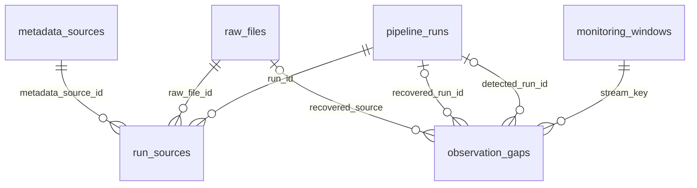

# Run lineage and gap registry — version 4

Four additive tables track operations without fabricating market data. Existing 14 market/reference tables and schema units are unchanged. No historical requests, new jobs or schedule changes were made.

| Table | Purpose and keys |
|---|---|
| pipeline_runs | JSONL run_id primary key; started_ms, ended_ms, mode, nullable trigger, running/succeeded/failed status, error |
| run_sources | run_id FK; exactly one raw_file_id or metadata_source_id FK; unique run/source pair |
| monitoring_windows | Composite PK exchange, symbol, dataset, interval; explicit start_ms, checked_through_ms, reconciled_ms |
| observation_gaps | Composite PK exchange, symbol, dataset, interval, bucket_end_ms; detection/reconciliation/recovery times, missing/recovered state, optional detection/recovery run FKs and recovered raw-file FK |



Missing gaps have NULL source/recovery references, enforced by CHECK constraints. Recovered gaps retain their first detection and recovery timestamps; their exact observation source is recorded. Gaps do not use forward fills, approximate joins or inferred token conversions.

## How it runs

`cli.main` holds the existing database lock, starts `lineage.tracked_run` using the existing JSONL ID, runs the unchanged fetch/loader controller, then reconciles and finalizes status. Final JSONL pipeline success occurs after reconciliation. Errors are persisted and re-raised; a killed process can leave status running, which means unfinished/unknown, not proven still active. Lock acquisition failures remain in JSONL only. Trigger is NULL: neither scheduler nor manual origin is inferred.

Run/source links mean **newly indexed by this run**, not necessarily fetched by this run. Previously indexed captures are not linked again on every replay. Raw responses from partial fetch failures may remain on disk without database IDs; JSONL remains their operational evidence until a later load indexes them. Historical runs are not reconstructed from filenames or missing logs. CoinGecko execution continues using its existing JSONL/source provenance; this milestone tracks the Binance five-minute controller.

`gaps.reconcile` owns no transaction; its caller commits the stream cursor and all gap changes together. New expected boundaries are scanned once after the saved cursor, including days when no process ran. Only unresolved gaps are subsequently rechecked via indexed exact-boundary lookups. Cost grows with new intervals and unresolved gaps, not all recovered history. A very large unresolved registry may eventually require chunking; none is needed for this local workload.

## Explicit monitoring policy

On first initialization, each stream starts at its earliest stored aligned boundary. If it has no observations, its start is the next boundary at initialization. These starts are permanently stored and shown in status; they are a documented monitoring policy, not proof collection was promised before then. The initial scan finds gaps within captured history, including multi-day absences. Nothing before the start is claimed covered.

The Python reconciliation interface accepts an explicit aligned `start_ms` for initial setup/testing. Existing starts are immutable through this interface; changing scope requires separate review. End boundaries advance to wall clock minus grace: candles **60 seconds**, OI **600 seconds**, rounded down to an exact UTC five-minute boundary. Clock regression never retreats the cursor. Grace is a diagnostic policy, not a provider SLA. OI may be delayed, omitted or unavailable; older missing OI does not prove provider failure. The earlier read-only one-hour coverage display remains unchanged, so it can show recent OI absent before the permanent registry considers it mature.

Recovered history is retained. Deletion of recovered market records is outside the supported ingestion contract and does not automatically reopen gaps. Data deletion requires a separate integrity investigation. Missing run records never establish that the scheduler did not execute.

## Read-only status

```bash
cd /Users/b/Developer/crypto-perpetuals-data-pipeline
source .venv/bin/activate
python -m crypto_pipeline.gaps status
python -m crypto_pipeline.gaps status --db-path /path/to/copy.sqlite3
python -m pytest -q -p no:cacheprovider
python scripts/validate_pipeline.py
python -m crypto_pipeline.schedule status
```

Status opens SQLite in read-only mode and reports coverage at the last reconciliation, per-stream missing/recovered counts, the three largest contiguous ranges, explicit window bounds, reconciliation timestamps, and latest successful tracked online collection. It does not mutate/reconcile/fetch. If collection has stopped, status can be stale; its timestamps expose that. After the next controller run, new elapsed boundaries are registered even if fetching failed. An execution that cannot access the database cannot record gaps until access returns.

## Initial validation snapshot

At 2026-11-12 08:39:47 UTC:

| Stream | Expected | Missing | Recovered |
|---|---:|---:|---:|
| BTC candles | 1621 | 1318 | 0 |
| PEPE candles | 1621 | 1318 | 0 |
| BTC OI | 1623 | 1314 | 0 |
| PEPE OI | 1623 | 1313 | 0 |

Largest missing candle range for both symbols: **2026-11-07 17:05 to 2026-11-12 05:25 UTC**, 1301 period ends. Largest OI ranges end 05:20 for BTC (1300) and 05:15 for PEPE (1299). Their starts are 17:05 on November 7. No outage cause is assigned. Initial latest tracked successful collection was unknown because tracking had just been installed; existing launchd inspection separately reported 1572 invocations and last exit code 0. These are different evidence sources.

110 tests pass. Tests cover multi-day intervals, grace, exact boundaries, unique constraints, recovery history/source links, run errors, unknown triggers, read-only status and repeat migrations, alongside existing migration backup and data-preservation tests. Live migration backed up the database and preserved every original market/reference row. Integrity OK, zero FK errors; existing audit verified 1304 Binance source checksums and two offline replays preserved all market/reference rows. Operational tables are now explicitly excluded from replay equality because execution tracking must change on every run. Source checksum and original financial-row checks remain intact.

## Future recovery, not implemented

A later approved recovery command can group missing keys into ranges and request exact source intervals, save raw responses, and use existing idempotent normalization. Candle requests use opening timestamps (bucket end minus 300000); OI retains exact source times. Recovery closes a gap only when its stored observation exists, not merely when an HTTP request succeeds.

[Binance market-data documentation](https://developers.binance.info/en/docs/catalog/core-trading-derivatives-trading-usd-s-m-futures/api/rest-api/market-data) currently specifies OI maximum 500 records and latest one month availability, with periods potentially omitted. Recheck limits/retention before implementation. USD-M kline pagination has a documented maximum 1500; the current collector intentionally caps its shared CLI limit at 500. Respect weights, rate limits and access restrictions. Older archive availability, schemas, checksums and timestamp/unit compatibility need independent verification; an archive is not guaranteed to contain missing OI. A recovery-attempt table is deferred until actual recovery is implemented; no empty speculative subsystem was added.
