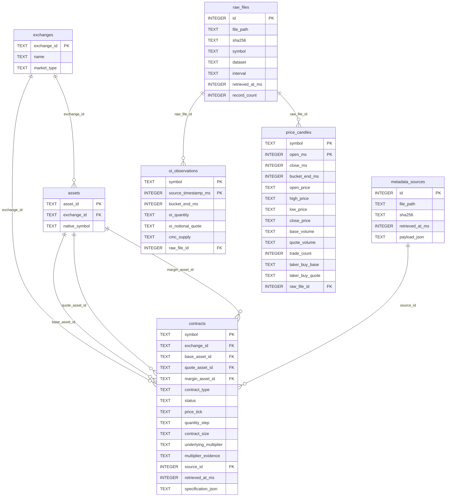

# Implemented SQLite schema (version 2)

Generated from the audited database PRAGMAs on 2026-11-06T22:20:33.350010+00:00. No schema changes were made during Phase 1.

Solid relationships below are actual SQLite foreign keys. The observation-to-contract relationship and OI-to-candle boundary join are application queries, not enforced foreign keys. All financial decimal values are TEXT; timestamps are INTEGER Unix milliseconds.

Composite primary keys: `oi_observations(symbol, source_timestamp_ms)` and `price_candles(symbol, open_ms)`. Unique constraints: `raw_files.file_path`, `metadata_sources.file_path`, `assets(exchange_id, native_symbol)`. Explicit nonunique query indexes: `idx_oi_bucket(symbol, bucket_end_ms)` and `idx_candle_bucket(symbol, bucket_end_ms)`. SQLite also creates indexes for the TEXT/composite primary keys and unique constraints. Integer primary keys alias the row ID.

Nullable non-key fields: `oi_observations.bucket_end_ms`, `oi_observations.cmc_supply`, `contracts.contract_size`, `contracts.underlying_multiplier`, `contracts.multiplier_evidence`. Other non-key fields are NOT NULL. SQLite rowid-table TEXT primary keys are not explicitly NOT NULL in this schema; ingestion validates identities, but direct SQL can bypass those checks.

`raw_files` indexes disk captures and checksums; it does **not** contain the market JSON payload. `metadata_sources` stores both the disk-source reference and original exchangeInfo payload. Contracts retain the latest selected specification; older full exchangeInfo snapshots remain in metadata_sources. Each observation retains its first accepted source ID.

The logical market join is `o.symbol = k.symbol AND o.bucket_end_ms = k.bucket_end_ms`. Joining only by symbol would multiply unrelated periods. Unaligned OI retains its source timestamp and NULL bucket end; it does not join.

Before multiple exchanges, introduce exchange-scoped contract IDs in observation keys and references. Before CoinGecko, introduce canonical identities and verified provider mappings: `binance_usdm:1000PEPE` is exchange-native, not a universal coin identity. Review explicit NOT NULL/CHECK constraints and enforce observation-to-contract references in a separately backed-up migration. No such migration is included here.
