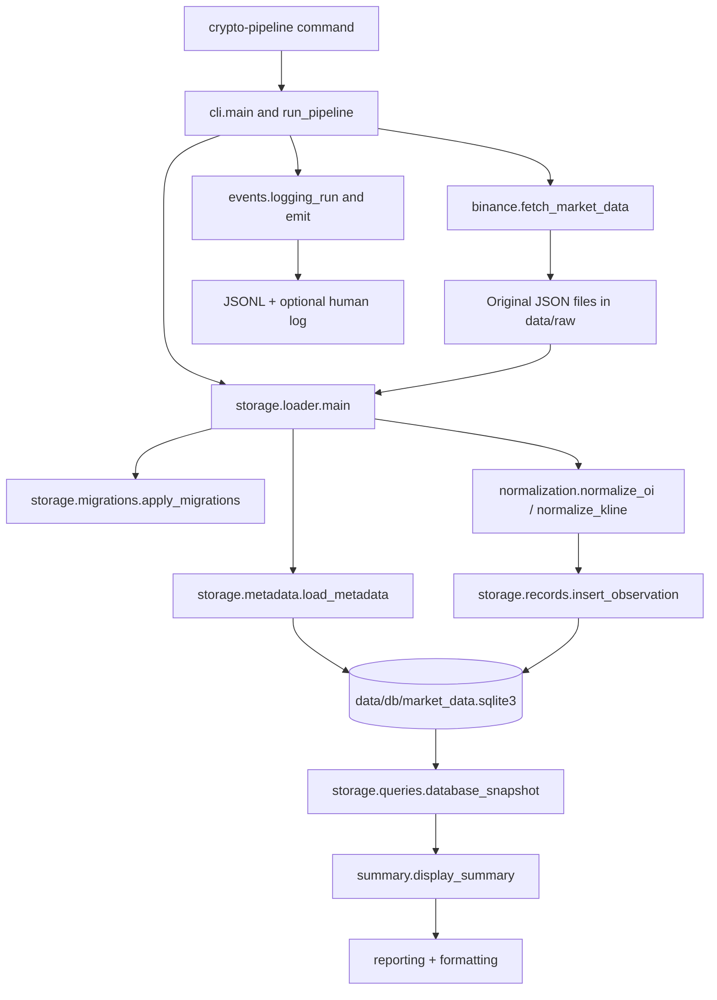

# Package walkthrough

The implementation currently defines functions and module constants, with no custom classes. It uses library classes such as pathlib.Path, decimal.Decimal and Rich Console, Text and Table. Functions make the current small sequence of transformations easy to test with fixtures and temporary databases. Introduce a stateful client or storage class when shared connection/session lifecycle warrants it.

## Execution path

## Design responsibilities

| Area | Reason for the boundary |
|---|---|
| cli.py and config.py | CLI options and execution order are separate from record validation. Module defaults retain compatibility with earlier scripts. |
| binance.py | HTTP requests and original-byte preservation are together so a response is saved before parsing. |
| normalization.py | Pure record validation returns ordinary dictionaries. Tests need neither network access nor SQLite. |
| time_utils.py and units.py | UTC arithmetic and Decimal calculations make timestamp and unit assumptions explicit. |
| storage/schema.py and migrations.py | Initial table definitions and upgrades are reviewable independently of file ingestion. Existing databases are backed up before schema changes. |
| storage/metadata.py | Real exchange specifications have different provenance and update rules from market observations. |
| storage/loader.py and records.py | File discovery/checksum validation and fixed-column SQL insertion have distinct responsibilities. |
| storage/queries.py | Database totals and exact-boundary joins are reusable by reports. |
| formatting.py, reporting.py and summary.py | Formatting transforms values, reporting builds Rich output, and summary assembles database results for display. |
| events.py | A context-local run ID associates file-only operational events with one execution. |

This is an incremental architecture. The Binance client still invokes presentation helpers, the loader still prints its summary, and CLI path overrides update module globals. Those choices preserve the earlier script entry points. Before concurrent in-process jobs or a second runner, pass configuration explicitly and return structured stage results to the CLI. The current command-line process runs one pipeline at a time.

## File and function inventory

Paths below are relative to `src/crypto_pipeline/`.

| File | Functions or module role | Custom classes |
|---|---|---|
| `__init__.py` | Package marker / module entry / constants | None |
| `__main__.py` | Package marker / module entry / constants | None |
| `binance.py` | `request_and_save`, `fetch_exchange_info`, `fetch_market_data`, `main` | None |
| `cli.py` | `display_stage`, `run_pipeline`, `main`, `display_run_logs`, `log_path_label`, `global_paths` | None |
| `config.py` | Package marker / module entry / constants | None |
| `events.py` | `emit`, `logging_run` | None |
| `formatting.py` | `format_number`, `format_price`, `format_timestamp`, `format_oi`, `format_kline` | None |
| `normalization.py` | `decimal_text`, `integer_value`, `normalize_oi`, `normalize_kline` | None |
| `reporting.py` | `display_heading`, `display_fields`, `display_saved_path`, `display_error`, `display_response`, `display_contract_metadata`, `count_with_growth`, `display_metric`, `display_market_summary` | None |
| `storage/__init__.py` | Package marker / module entry / constants | None |
| `storage/loader.py` | `load_files`, `main` | None |
| `storage/metadata.py` | `load_metadata` | None |
| `storage/migrations.py` | `backup_database`, `apply_migrations` | None |
| `storage/queries.py` | `database_snapshot` | None |
| `storage/records.py` | `insert_observation` | None |
| `storage/schema.py` | Package marker / module entry / constants | None |
| `summary.py` | `display_summary` | None |
| `time_utils.py` | `filename_timestamp_ms`, `utc_label`, `detect_interval` | None |
| `units.py` | `quote_delta`, `underlying_quantity` | None |
The scripts directly under `src/` are compatibility entry points, except `connectivity_probe.py`, which preserves the earlier connectivity experiment. `__main__.py` enables `python -m crypto_pipeline`. The package `__init__.py` files identify package boundaries. Tests cover normalization, source retrieval behavior, database integrity and migration, logs, terminal details and offline execution.

## What the November 6 online run stored

| Destination | Run change | Resulting total |
|---|---|---|
| data/raw | Five original JSON responses | Four observation responses and one exchangeInfo response for this run |
| raw_files | Four file indexes with checksums and retrieval details | 52 rows |
| oi_observations | Three observations per contract | 36 rows |
| price_candles | Two completed candles per contract | 22 rows |
| metadata_sources | One exchangeInfo payload, path, checksum and retrieval time | 2 rows |
| contracts | Refresh latest specifications for both contracts | 2 rows |
| exchanges / assets | Existing native identifiers reused | 1 exchange / 3 assets |

`raw_files` stores source-file metadata, not the observation JSON payload. OI/candle source bytes live on disk. `metadata_sources` does also store the full exchangeInfo JSON, and `contracts` retains the selected specification JSON. Normalized observations link back to their indexed source file.

The run fetched near 21:24 UTC. Its candle opening at 21:20 was still in progress, so each contract contributed two completed candles. Six OI observations were eligible immediately. The loader rescans historical raw files on every run, so 22 unfinished-candle skips includes 20 previously encountered records and two newly fetched ones. Old captures remain unfinished snapshots even after wall-clock time advances. Future completed captures supply the eligible candle.

The fetch screen shows only the first record as a sample although each response contains three. The table's latest timestamp is the newest completed candle's exclusive end, explaining the 21:20 value.

## Next implementation

Build a read-only coverage command over explicit UTC start/end boundaries, with separate candle and OI expectations per contract. Follow with live REST recovery of recent missing intervals, retries, overlap, and protection against concurrent writers. Then schedule the command locally.

For macOS, use launchd calendar scheduling. Apple documents that a job missed during sleep can run upon wake, coalescing missed invocations. The pipeline must still enumerate missing data windows itself. Cron is available, but its sleeping-machine behavior needs explicit recovery. [Apple timed-job documentation](https://developer.apple.com/library/archive/documentation/MacOSX/Conceptual/BPSystemStartup/Chapters/ScheduledJobs.html)

Airflow and Databricks are future options. The current implementation uses neither. Data-interval definitions and rerunnable ingestion can be implemented directly in this Python package and reused by an orchestrator later.
